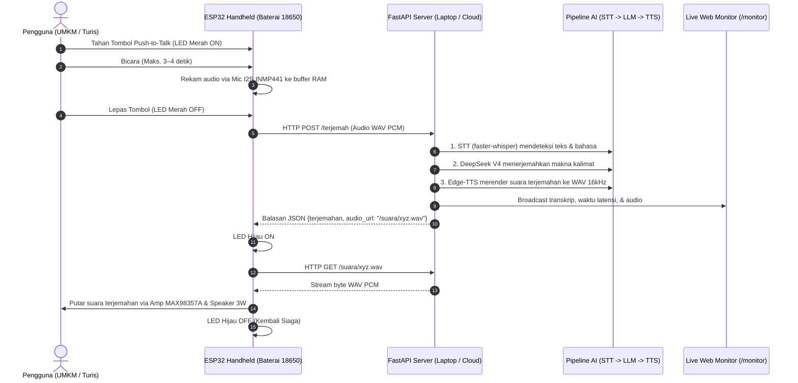

# 🎙️ Smart Portable Voice Translator (Speaker Pintar Penerjemah Dua Arah)
### Proyek Praktikum Internet of Things (IoT) — Semester Ganjil

> **Institusi:** Politeknik Pertanian Negeri Samarinda (Politani)  
> **Program Studi:** D4 Teknologi Rekayasa Perangkat Lunak (TRPL), Kelas 3A  
> **Dosen Pengampu:** Bapak Imron  
> **Tim Pengembang (Kelompok 3):**
> 1. **Bhayu Satria Sugara (Jian)** — NIM: H253600447
> 2. **Haikal**
> 3. **Egi**

---

## 1. Ringkasan Proyek

**Smart Portable Voice Translator** adalah perangkat IoT komunikasi suara genggam (*handheld walkie-talkie style*) yang mampu menerjemahkan percakapan lisan secara otomatis antara **Bahasa Indonesia ↔ Bahasa Inggris** secara dua arah (*bidirectional*).

Dirancang khusus untuk mendukung **UMKM lokal, pedagang pasar, dan pemandu wisata** saat bertransaksi dengan wisatawan mancanegara tanpa repot menekan menu aplikasi atau mengatur arah bahasa secara manual.

### Fitur Kunci:
- **One-Button Push-to-Talk (PTT):** Cukup tahan tombol untuk berbicara dan lepas saat selesai. Arah terjemahan dideteksi secara otomatis oleh AI.
- **Portabilitas Mandiri (Rechargeable Battery):** Ditenagai baterai Li-Ion 18650 internal dengan modul pengisian ulang USB dan booster 5V di dalam casing saku Kotak X6.
- **WiFiMulti Auto-Connect:** Otomatis berpindah dan menyambung ke Hotspot Smartphone atau WiFi Kampus tanpa perlu mem-flash ulang program.
- **WAV PCM Direct I2S Streaming:** Server langsung merender audio ke format raw WAV 16-bit sehingga ESP32 tidak memerlukan decoder MP3 yang membebani chip.
- **Live Visualizer Web Monitor:** Dashboard pemantau transkrip, latensi, dan audio playback secara real-time via antarmuka web modern (*Clean Light Mode*).

---

## 2. Arsitektur & Alur Kerja Sistem



---

## 3. Spesifikasi Perangkat Keras & Pinout (7 GPIO Bebas Konflik)

Alat menggunakan rancangan **Headless Mode (#define PAKAI_LCD 0)** dan **1 Status LED** yang memangkas kebutuhan pin dan membuat perakitan sangat ringkas:

| Komponen | Pin Modul | Pin ESP32 DevKit | Keterangan & Fungsi |
|:---|:---:|:---:|:---|
| **Mikrofon Digital INMP441** | VDD | **3.3V** | *PENTING: Jangan sambung ke 5V!* |
| | GND | **GND** | Ground bersama |
| | SCK | **GPIO 32** | Serial Clock I2S Input |
| | WS | **GPIO 33** | Word Select / L-R Clock |
| | SD | **GPIO 34** | Serial Data (Input Only) |
| | L/R | **GND** | Mengunci ke channel kiri |
| **Amplifier DAC MAX98357A** | VIN | **5V (VOUT Boost)** | Suplai daya penguat 3 Watt |
| | GND | **GND** | Ground bersama |
| | BCLK | **GPIO 26** | Bit Clock I2S Output |
| | LRC | **GPIO 25** | Left/Right Clock (WSEL) |
| | DIN | **GPIO 22** | Digital Audio Input |
| | OUT+ & OUT- | Speaker 8Ω 3W | Terminal 2 kabel speaker mini |
| **Push Button (Push-to-Talk)** | Kaki 1 / 2 | **GPIO 27 & GND** | Internal `INPUT_PULLUP` (tanpa resistor luar) |
| **LED Indikator Status (1 LED)** | Anoda / Katoda | **GPIO 13 & GND** | Seri R 220Ω (Atau onboard LED GPIO 2) |

### Rangkaian Daya Portabel (Opsi B):
```
[Baterai Li-Ion 18650 (3.7V)] 
       │
   (Holder)
       │
[Saklar On/Off SPDT] ──> [Modul TP4056 + Step-Up 5V] ──(5V DC)──> [VIN ESP32 & VIN MAX98357A]
                                 ▲
                     [Port Charger USB Type-C]
```

---

## 4. Struktur Direktori Repositori

```text
├── README.md                  <-- Dokumentasi utama proyek ini
├── AGENTS.md / GEMINI.md      <-- Memori teknis & konteks tim pengembang
├── komponen.md                <-- Panduan pengadaan komponen, BOM, & belanja Samarinda
├── Alat ESP32/                <-- Proyek Firmware ESP32 (PlatformIO)
│   ├── platformio.ini         <-- Konfigurasi board esp32dev & dependensi library
│   ├── src/
│   │   └── main.cpp           <-- Logika utama firmware (I2S DMA, WiFiMulti, HTTP Client)
│   └── README.md              <-- Panduan pengkabelan & instruksi flash
└── Server/                    <-- Server Pemrosesan Audio & AI (FastAPI)
    ├── server_terjemah.py     <-- Entry point FastAPI (/terjemah, /suara, /monitor)
    ├── pipeline.py            <-- Pipeline AI (STT faster-whisper, DeepSeek V4, Edge-TTS)
    ├── konfigurasi.py         <-- Konfigurasi port, path cache, dan gateway LLM
    ├── uji_pipeline.py        <-- Skrip pengujian alur terjemahan via terminal
    ├── buat_sampel.py         <-- Generator file suara uji (Indonesia & Inggris)
    ├── riwayat.jsonl          <-- Log riwayat transkrip & percakapan
    ├── templates/
    │   └── monitor.html       <-- Antarmuka Live Dashboard Monitor (Clean Light Mode)
    ├── sampel_audio/          <-- Folder audio sampel WAV/MP3
    └── suara_hasil/           <-- Cache file WAV hasil TTS yang siap disajikan ke alat
```

---

## 5. Panduan Menjalankan Sistem

### A. Persiapan Sisi Server (Laptop Jian)
1. Masuk ke folder server:
   ```powershell
   cd "D:\Politani\Semester 3\IoT\Proyek Speaker Penerjemah\Server"
   ```
2. Jalankan server FastAPI:
   ```powershell
   python server_terjemah.py
   ```
   *Server berjalan di `http://0.0.0.0:8000`*.
3. Buka Dashboard Live Monitor di browser:
   👉 **`http://localhost:8000/monitor`**
4. *(Opsi Portabel Jarak Jauh)* Jalankan Cloudflare Tunnel gratis:
   ```powershell
   cloudflared tunnel --url http://localhost:8000
   ```

### B. Membangun & Mengunggah Firmware ke ESP32
1. Hubungkan ESP32 DevKit ke laptop melalui kabel Micro-USB.
2. Buka PowerShell dan arahkan ke folder firmware:
   ```powershell
   cd "D:\Politani\Semester 3\IoT\Proyek Speaker Penerjemah\Alat ESP32"
   python -m platformio run                       # Memverifikasi kompilasi
   python -m platformio run -t upload             # Mengunggah program ke ESP32
   python -m platformio device monitor --baud 115200 # Membuka serial monitor
   ```

---

## 6. Petunjuk Demonstrasi Praktikum di Depan Dosen

1. **Hidupkan Alat:** Geser saklar daya ke posisi **ON**.
2. **Koneksi Otomatis:** LED Merah berkedip perlahan. ESP32 secara nirkabel menyambung ke Hotspot Smartphone / WiFi Kampus via `WiFiMulti`.
3. **Indikator Siap:** LED Hijau berkedip 2 kali menandakan alat telah siap siaga (*Ready*).
4. **Mulai Berbicara:** Tekan dan tahan tombol (LED Merah menyala), katakan satu kalimat (misal: *"Berapa harga satu porsi nasi goreng?"*), lalu lepas tombol.
5. **Dengarkan Terjemahan:** Server memproses dalam ~3-4 detik. LED Hijau menyala dan speaker otomatis mengucapkan: *"How much is one portion of fried rice?"* secara lantang dan jernih.
6. **Pantau Hasil:** Buka layar laptop dosen/penguji pada halaman `http://<ip-laptop>:8000/monitor` untuk melihat teks asli, terjemahan, dan latensi pemrosesan.

---
*Proyek ini dikembangkan oleh Kelompok 3 TRPL 3A Politani Samarinda untuk memenuhi tugas praktikum mata kuliah Internet of Things (IoT).*
